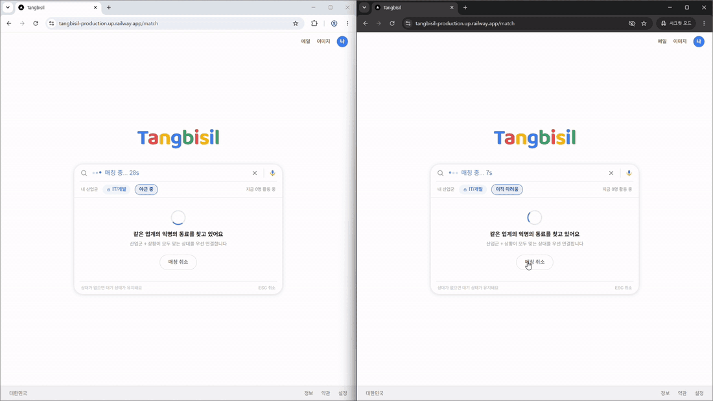
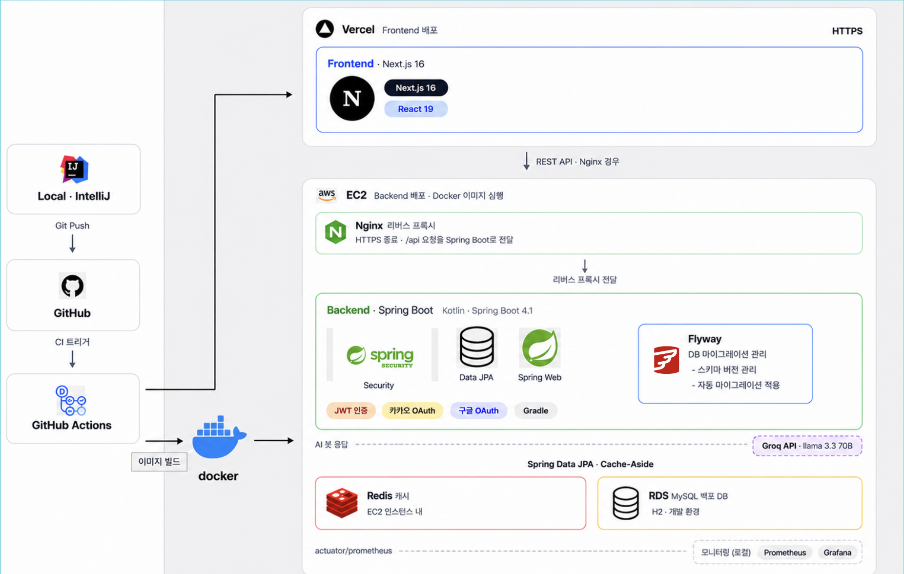

# ☕️ 탕비실 (Tangbisil)

> 직장인이 업무 중 쌓인 스트레스를 바로 털어놓을 수 있도록, **같은 산업군·같은 상황의 익명 동료와 실시간으로 연결**해 주는 매칭형 채팅 서비스

상황 하나만 고르면 바로 연결되고(즉시성), 상대에게는 끝까지 '익명의 동료'로만 보이며(익명성), 대화는 10분 뒤 끝나고 24시간 뒤 사라집니다(휘발성).

이 저장소는 프로그래머스 백엔드 데브코스 10기 **2차·3차 팀 프로젝트(같은 주제)를 하나로 정리한 개인 fork**입니다. 아래 "내 기여"는 제가 작성한 PR 기준입니다.

| 단계 | 기간 | 언어 | 원본 저장소 |
| --- | --- | --- | --- |
| 2차 | 2026.06.22 ~ 07.10 (3주) | Java | [prgrms-be-devcourse/NBE10-12-2-UTF-8](https://github.com/prgrms-be-devcourse/NBE10-12-2-UTF-8) |
| 3차 | 2026.07.30 ~ 08.06 (1주) | Java → Kotlin | [NBE10-12-UTF-8/Tangbisil](https://github.com/NBE10-12-UTF-8/Tangbisil) |

> 3차 마지막 날 팀에서 백엔드 코드를 Kotlin으로 일괄 전환했습니다. 제 3차 작업은 Java로 작성했고, 원본 코드는 아래 "관련 PR"에서 볼 수 있습니다.



*2차 시연 영상 일부(1.5배속): 매칭 성사 → 채팅 → 메시지 신고 → 퇴장 시 채팅방 종료. 배포는 종료되었습니다.*

---

## 내 역할 한눈에 보기

| 단계 | 담당 | 핵심 |
| --- | --- | --- |
| 2차 | 채팅방 생명주기 | 방 생성·조회·종료 API, 10분 자동 종료 스케줄러, 재입장(활성 방 조회) |
| 2차 | 신고·증거 보존, 회원 제재 | 신고 시점 이전 대화 30개를 커밋 후 비동기로 보존, 관리자 신고 처리, 정지 회원 즉시 차단 |
| 2차 | Redis 도입 PoC (미머지) | 매칭 대기열·채팅 캐시 실험 → 3차 설계의 근거 |
| 3차 | 매칭 대기열 Redis 전환 | Redis ZSet 대기열 + 업종별 Redisson 분산 락 + 트랜잭셔널 아웃박스 |
| 3차 | 채팅 메시지 Redis 캐시 | 폴링 조회를 Redis ZSet 캐시로, 장애 시 DB 우회 |
| 3차 | 동시 매칭 커넥션 고갈 해결 | 배포 환경 100명 동시 매칭에서 드러난 커넥션 풀 고갈 원인 분석·수정 |

---

## 시스템 구성도



- 프론트엔드는 Vercel, 백엔드는 EC2의 Docker 컨테이너(Nginx 리버스 프록시 뒤)로 배포합니다. GitHub Actions가 이미지를 빌드해 Docker Hub에 올리고 EC2에 배포합니다.
- 그림의 Redis는 "캐시"로만 적혀 있지만 실제 역할은 세 가지입니다: **매칭 대기열(ZSet)**, **업종별 분산 락(Redisson)**, **채팅 메시지 캐시**. 채팅 실시간 송수신은 WebSocket(STOMP)입니다.

---

## 핵심 기여

### 1. 매칭 대기열을 Redis로 옮기고 동시성 제어를 DB 밖으로

**문제**: 2차 매칭은 `UPDATE ... WHERE status = 'PENDING'` 조건부 UPDATE가 거는 레코드 락으로 상대를 선점했습니다. 중복 매칭은 막았지만, 신청 요청 안에서 매칭까지 한 트랜잭션으로 처리해 **매칭이 끝날 때까지 DB 커넥션과 행 락을 쥐고 있는 구조**였습니다. 동시 요청이 몰리면 커넥션 풀이 먼저 바닥납니다.

**설계**
- 대기열: 업종·상황별 Redis ZSet(`match:queue:{업종}:{상황}`), score = 신청 시각
- 동시성: 업종별 Redisson 분산 락(`match:lock:{업종}`). 다른 업종끼리는 매칭되지 않으니 전체 락 대신 업종 단위로 나눴습니다. 상황 단위가 아닌 이유는, 15초·30초가 지나면 같은 업종의 다른 상황과도 매칭되기 때문입니다.
- 정합성: 신청 트랜잭션 안에서 아웃박스를 함께 저장하고, **커밋 이후** Redis에 적재합니다. 적재에 실패하면 스케줄러가 10초마다 최대 5회 재적재합니다. (2차 PoC에서 시도한 Cache-Aside는 매 신청마다 대기열을 지우고 다시 만들어 사실상 항상 캐시 미스였기 때문에 버렸습니다.)
- 순서: 매칭 처리를 별도 트랜잭션(`REQUIRES_NEW`)으로 커밋한 뒤 락을 풀어, 다른 스레드가 커밋 전 데이터를 보지 않게 했습니다.
- 매칭 요청은 커밋 후 비동기로 처리해 신청 API는 저장만 하고 바로 응답합니다.

### 2. 트러블슈팅: 분산 락 대기 중 DB 커넥션 고갈

**문제**: 배포 환경에서 100명 동시 매칭 부하 테스트를 하자, Redis 버전은 대부분의 요청이 PENDING에 머물다 35초 뒤 봇과 매칭됐습니다. 같은 테스트에서 RDB 버전은 느려도 100명 모두 매칭됐습니다.

**원인**: 락을 기다리는 스레드가 DB 커넥션을 쥐고 있었습니다. 커넥션 풀(Hikari 기본 10개)을 대기자들이 다 잡고 있으니 락을 얻은 스레드가 커넥션을 못 받고, 대기자들은 락 대기 시간(5초)을 넘겨 조용히 포기했습니다.
- 비동기 매칭 진입점의 `@Transactional(REQUIRES_NEW)`가 락을 잡기 전부터 커넥션을 점유
- 이걸 지워도 클래스 레벨 `@Transactional(readOnly = true)`가 락 획득 메서드에 **상속**돼, 첫 조회 때 잡은 커넥션을 락 대기 내내 쥐고 있었음
- 대기열 상위 2명만 조회해 앞사람이 막히면 뒤 전체가 멈춤(Head-of-Line Blocking), 락 1회에 1쌍만 매칭

**해결**
- 락 획득 메서드를 `@Transactional(propagation = NOT_SUPPORTED)`로 트랜잭션 밖으로 분리하고, DB 쓰기는 쌍 단위 `REQUIRES_NEW`로 짧게 커밋
- 후보를 상위 N명으로 조회(IN절 일괄 조회), 락 하나로 여러 쌍을 연속 매칭하는 배치 루프(leaseTime 없이 Redisson watchdog 사용)
- 동일 시각 요청은 `requestedAt` + `id`로 정렬해 항상 같은 후보를 선택
- 배포 후 지연 보정: 락 대기 5→10초, 후보 20→50명, 백업용 스케줄러는 락 대기 0초로 바꿔 스케줄러 스레드가 막히지 않게 함

**검증**: 테스트 커넥션 풀을 3개로 줄여 재현했습니다. 수정 전 10명 중 8명이 PENDING으로 남았고, 수정 후 10명 모두 매칭됐습니다. 10명 동시 매칭 테스트를 추가했습니다.

**결정**: 로컬에서는 풀을 30개로 늘리면 100명이 통과했지만 늘리지 않았습니다. Before(RDB)와 풀 설정이 달라지면 개선이 코드 덕인지 풀 덕인지 구분할 수 없어서입니다.

**결과**: 배포 환경 100명 동시 신청에서 100/100 매칭, 커넥션 풀은 "pending 치솟음·idle 0"에서 "순간 피크 후 즉시 해소"로 바뀌었습니다. (아래 성능 검증 참고)

### 3. 채팅 메시지 Redis 캐시

**문제**: 2차 채팅은 2초 폴링이라 대화 중인 방마다 요청이 계속 DB로 갑니다.

**설계**
- 메시지 저장이 **커밋된 뒤** `@Async` 리스너가 방별 ZSet(score = 생성 시각, TTL 2시간)에 적재
- 조회는 마지막 수신 시각(`after`) 이후를 ZSet 범위 조회로, Redis 예외 시 DB로 우회, 캐시가 없으면 DB에서 읽어 다시 채움
- 적재 실패 시 그 방의 캐시 키를 지워 다음 조회 때 DB에서 재구성, 채팅방 종료 시 키 즉시 삭제
- 새 메시지가 없어 결과가 비어도 키가 있으면 캐시 히트로 처리. 처음엔 빈 결과를 미스로 처리해, 새 메시지 없는 폴링마다 방 전체를 DB에서 다시 읽고 있던 것을 고쳤습니다.

**결과**: 폴링 조회 평균 응답 5,209 → 402ms, 커넥션 pending 80+ → 약 40. 이후 팀원이 WebSocket으로 전환했고, 캐시는 입장 시 전체 조회와 재연결 시 누락분 조회에 계속 쓰입니다.

### 4. 2차: 채팅방 생명주기

- 매칭 성공 시 방 생성과 "익명의 동료" 참여자 등록, 참여자 생성은 참여자 서비스에 위임
- 방 종료는 논리적 상태 변경이라 팀 논의 후 DELETE 대신 PATCH, 엔티티는 setter 없이 `close()`로만 상태 변경
- 생성 10분이 지난 방을 1분 주기 스케줄러가 종료
- 비참여자 403, 활성 방 조회 API로 앱 재진입 시 진행 중인 방으로 자동 이동
- 테스트를 먼저 작성(403/404/409 케이스)

### 5. 2차: 신고·증거 보존과 회원 제재

- **휘발성과 증거 보존의 충돌**: 메시지는 24시간 뒤 삭제되므로, 신고 시점 이전 대화 최대 30개를 별도 테이블에 복사합니다. 원본이 지워져도 깨지지 않게 FK를 걸지 않았습니다.
- 증거 복사는 신고 커밋 후 `@Async` + `@TransactionalEventListener(AFTER_COMMIT)` + `REQUIRES_NEW`로 처리해 신고 응답을 기다리게 하지 않았습니다. 이벤트에는 엔티티 대신 ID를 넘겨 지연 로딩 예외를 피했고, `@EntityGraph`로 N+1을 없앴습니다.
- 관리자 신고 목록은 상태 필터를 DB에서 처리해 페이지 너머의 미처리 신고가 누락되던 문제를 고쳤습니다. 신고 상세는 신고자·피신고자·제3자를 익명 라벨로 구분합니다.
- 정지 회원은 인증 필터에서 매 요청 DB를 확인해 즉시 차단합니다.

### 6. 2차: Redis 도입 PoC — 머지하지 않은 결정

매칭 대기열·채팅 캐시에 Redis를 넣어 로컬에서 측정했습니다(매칭 평균 603→312ms, 로컬 루프백 환경이라 참고치). DB 롤백 시 Redis에 유령 대기자가 남는 문제(→ 커밋 후 적재)와, Cache-Aside가 대기열에 맞지 않는 문제를 겪었고 2차 기간 안에 안정화하기 어렵다고 판단해 머지하지 않았습니다. 이 경험이 3차의 아웃박스 설계로 이어졌습니다.

### 관련 PR

| 기여 | PR |
| --- | --- |
| 매칭 대기열 Redis 전환 | [3차 #78](https://github.com/NBE10-12-UTF-8/Tangbisil/pull/78) |
| 커넥션 고갈 해결 | [3차 #110](https://github.com/NBE10-12-UTF-8/Tangbisil/pull/110) · [#116](https://github.com/NBE10-12-UTF-8/Tangbisil/pull/116) · [#117](https://github.com/NBE10-12-UTF-8/Tangbisil/pull/117) |
| 채팅 메시지 캐시 | [3차 #50](https://github.com/NBE10-12-UTF-8/Tangbisil/pull/50) |
| 채팅방 생명주기 | [2차 #36](https://github.com/prgrms-be-devcourse/NBE10-12-2-UTF-8/pull/36) · [#72](https://github.com/prgrms-be-devcourse/NBE10-12-2-UTF-8/pull/72) 외 |
| 신고·증거 보존, 회원 제재 | [2차 #96](https://github.com/prgrms-be-devcourse/NBE10-12-2-UTF-8/pull/96) · [#122](https://github.com/prgrms-be-devcourse/NBE10-12-2-UTF-8/pull/122) · [#135](https://github.com/prgrms-be-devcourse/NBE10-12-2-UTF-8/pull/135) · [#111](https://github.com/prgrms-be-devcourse/NBE10-12-2-UTF-8/pull/111) |
| Redis PoC (미머지) | [2차 #162](https://github.com/prgrms-be-devcourse/NBE10-12-2-UTF-8/pull/162) |

---

## 성능 검증 (3차, 배포 환경)

AWS EC2 배포 서버를 대상으로 JMeter 100 threads, Prometheus + Grafana로 관측했습니다. Before/After는 각 버전을 배포해 같은 조건으로 측정했습니다. (측정은 팀원 진행)

**매칭 (100명 동시 신청)** — Before: RDB(레코드 락) / After: Redis 대기열 + 커넥션 고갈 수정

| 항목 | Before | After |
| --- | --- | --- |
| 매칭 신청 API 평균 응답 | 4,318 ms | 811 ms |
| 매칭 신청 API 최대 응답 | 8,830 ms | 1,416 ms |
| 매칭 성공 | 100 / 100 | 100 / 100 |
| DB 커넥션 풀 | pending 치솟음, idle 0 | 순간 피크 후 즉시 해소 |

> 신청 API 응답이 줄어든 데에는 매칭을 신청 요청에서 떼어 내 비동기로 처리한 효과가 큽니다. "매칭 자체가 81% 빨라졌다"는 뜻이 아닙니다.

**채팅 (2인 방, 100 threads, 60초)**

| 지표 | 폴링 + DB | 폴링 + Redis 캐시 | WebSocket |
| --- | --- | --- | --- |
| 조회(GET) 평균 응답 | 5,209 ms | 402 ms | — |
| 전송(POST) 평균 응답 | 3,843 ms | 160 ms | 10 ms |
| DB 커넥션 pending | 80건 이상 | 약 40건 | 거의 0 |

---

## 한계와 개선한다면

- **업종당 락 1개로 매칭을 직렬화**: 정확성은 지키지만 한 업종에 요청이 몰리면 처리량이 락 하나에 묶입니다.
- **설정값 근거 부족**: 커넥션 풀 10, 배치 상한 200, 후보 50명, 락 대기 10초는 측정으로 정한 값이 아닙니다.
- **락 획득 실패가 조용함**: 실패 로그·메트릭이 없어 배포 환경에서 원인을 찾기 어려웠습니다.
- **(회원, 상태) 유니크 제약 없음**: 연타 시 대기 중 요청이 2개 생길 수 있습니다.
- **스케줄러 종료 방식**: 방마다 UPDATE가 나갑니다. 벌크 UPDATE와 (status, createdAt) 인덱스로 바꿀 수 있습니다.
- **토큰 클레임**: 익명 서비스인데 액세스 토큰에 이메일이 들어 있고, 권한(role)은 토큰 값을 믿어 회수가 만료 전까지 반영되지 않습니다.

---

## 기술 스택

| 구분 | 기술 |
| --- | --- |
| Backend | Java(2차·3차 원본) → Kotlin(3차 최종), Java 25, Spring Boot 4.1, Spring Security, Spring Data JPA, Spring WebSocket(STOMP), Flyway |
| Database | H2(개발) / MySQL(배포) |
| Cache / Lock | Redis(매칭 대기열·채팅 캐시), Redisson 3.43(분산 락) |
| Infra | Docker, GitHub Actions → Docker Hub → AWS SSM → EC2 |
| 모니터링·테스트 | Spring Actuator, Prometheus, Grafana, JMeter, JUnit 5 |
| Frontend | Next.js 16, React 19 |

## 실행 방법

```bash
# Backend (dev 프로필, H2)
cd back && ./gradlew bootRun          # http://localhost:8080, Swagger: /swagger-ui/index.html

# Redis
cd redis && docker compose up -d

# Frontend
cd front && npm install && npm run dev  # http://localhost:3000
```

소셜 로그인은 `GOOGLE_CLIENT_ID`, `GOOGLE_CLIENT_SECRET`, `KAKAO_CLIENT_ID`, `KAKAO_CLIENT_SECRET` 환경 변수가 필요하고, AI 봇 응답은 `GROQ_API_KEY`가 있어야 동작합니다.

## 팀

| 이름 | 2차 | 3차 |
| --- | --- | --- |
| 여준 | 회원 API, AI 봇, 프론트엔드 | 인프라 재구축, 이메일 인증, 알림 |
| 이수민 | 매칭 API, 소셜 로그인, 배포 | 키워드 트렌드, 소셜 로그인/쿠키 |
| **이준형** | 채팅방 API, 신고 API, Redis PoC | 매칭 대기열·채팅 메시지 Redis, 동시 매칭 커넥션 고갈 해결 |
| 최성혁 | 채팅 메시지 API, 유사도 매칭, 부하 테스트 | 채팅 WebSocket(STOMP), 부하 테스트 |

멘토: 이택민 멘토님
